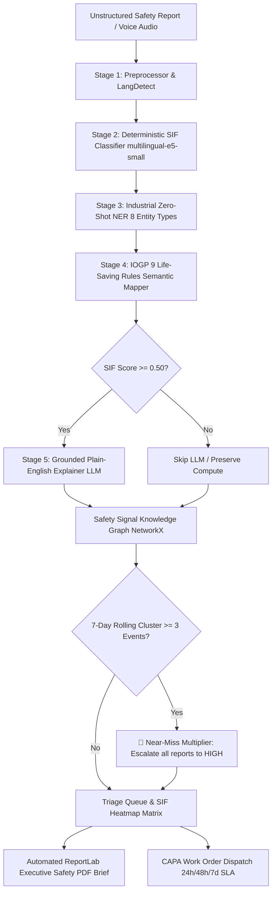

# 🛡️ SANKET · AI — SIF Precursor Detection Platform
### Smart India Hackathon 2026 · Problem Statement SIH26165
**Ministry of Petroleum and Natural Gas · Oil India Limited (OIL)**

> *"See the Sanket (Signal) Before It Becomes the Incident."*

---

## 📌 Executive Summary
**SANKET · AI** is a defense-grade, sovereign AI/NLP platform engineered specifically for **Oil India Limited** to ingest unstructured safety observations, near-miss reports, and equipment maintenance logs, continuously discovering hidden **SIF (Serious Injury & Fatality) precursors** before cascading disasters occur.

The system features a **modular monolith architecture** powered by a **5-stage deterministic AI/NLP pipeline**, a **7-agent LangGraph intelligence swarm**, a **Safety Signal Knowledge Graph (NetworkX)** with automated **Near-Miss Multiplier cluster detection**, in-process **FastMCP tool protocol integration**, and a **sovereign air-gapped runtime with verified zero-egress isolation**.

---

## 🏛️ System Architecture



---

## 🚀 Key Features & Deliverables

### 1. 🗺️ SIF-Precursor Density Heatmap (Headline Deliverable)
- Computes risk concentration matrix: $D_{\text{SIF}} = \frac{\text{Confirmed SIFp Reports}}{\text{Total Reports}} \times 100$
- Ranks every Oil India asset (Well Pad 7, Moran OCS-3, Baghjan Well #5, Digboi, Duliajan) across activities (Drilling, Workover, Wireline, Pipeline, Hot Work).

### 2. ⚡ 5-Stage Scientific NLP Pipeline
- **Stage 1 (Preprocessing):** Unicode NFC normalization, HTML entity repair, multilingual language detection (`en`, `hi`, `as`, `bn`).
- **Stage 2 (SIF Classifier):** Cosine similarity against 50 calibrated SIF reference anchors + 5-token negation window parser (`"no explosion occurred"` does not trigger false positive boosts).
- **Stage 3 (Zero-Shot Industrial NER):** Extracts 8 entity types (`EQUIPMENT`, `LOCATION`, `BARRIER_FAILURE`, `ENERGY_SOURCE`, `SHIFT_TIME`, `WEATHER_CONDITION`, `PPE_STATUS`, `BODY_PART`).
- **Stage 4 (IOGP Life-Saving Rules):** Vector cosine matching against official 9 IOGP rules with mandatory barrier inspection tags.
- **Stage 5 (Grounded Explainer):** 2-sentence risk synthesis citing physical barrier failures and energy sources (Dual-mode: Groq API online / Local Ollama offline).

### 3. 🕸️ Safety Signal Knowledge Graph & Near-Miss Multiplier
- In-memory **NetworkX graph** with Cytoscape.js interactive visualization.
- **Near-Miss Multiplier:** Automatically detects temporal co-occurrence of 3+ low/medium precursor events within a 7-day rolling window at the same equipment or location, escalating risk to HIGH.

### 4. ⏪ Baghjan 2020 "Time Machine" Disaster Replay
- Interactive 14-day chronological simulator demonstrating how SANKET would have detected cascading pressure fluctuations, cellar pit gas bubbling, and valve bypasses 14 to 3 days before the Baghjan Well #5 blowout.

### 5. 🎙️ Multilingual Field Worker Voice Portal
- Integrated with local **OpenAI Whisper STT** for speech-to-text safety reporting in Hindi, Assamese, Bengali, and English.

### 6. 📄 Boardroom-Ready Executive PDF Briefs
- Automated **ReportLab PDF generator** outputting single-page executive briefs with SIF gauge, incident narrative, AI risk synthesis, entity decomposition, and CAPA work order.

### 7. 🤖 LangGraph 7-Agent Swarm & FastMCP Tools
- Sequential multi-agent DAG orchestrated via `StateGraph(ReportState)` across 7 specialized agents: `Supervisor`, `Classifier`, `EntityExtractor`, `RuleMapper`, `GraphAnalyst`, `Explainer`, and `ActionAgent`.
- 4 FastMCP tools: `query_past_incidents`, `lookup_iogp_rule`, `detect_graph_clusters`, `generate_executive_pdf_brief`.

---

## 🔑 Role-Based Access Control (RBAC) & Demo Credentials

| Role | Username | Password | Access Level |
| :--- | :--- | :--- | :--- |
| **System Administrator** | `admin` | `admin123` | Full admin privileges & system settings |
| **HSE General Manager** | `rajesh` | `rajesh123` | Executive SIF Heatmap, Replay, PDF dispatch |
| **Site Safety Officer** | `priya` | `priya123` | Triage Queue, Human-in-the-Loop review, CAPA |
| **Field Worker** | `bikash` | `bikash123` | Voice & Quick observation portal |

---

## 🛠️ Quick Start & Running Locally

### 1. Backend Setup (FastAPI)
```bash
# Install Python dependencies
pip install -r requirements.txt

# Generate synthetic dataset (507 realistic Oil India reports)
python scripts/generate_synthetic_data.py

# Seed database with demo users & reports
python scripts/seed_db.py

# (Optional) Run batch processor through 5-stage NLP pipeline
python scripts/process_all_reports.py

# Launch FastAPI server (port 8000)
uvicorn backend.main:app --reload --port 8000
```

### 2. Frontend Setup (Next.js 16)
```bash
# Navigate to frontend directory
cd frontend

# Install Node dependencies
npm install

# Start Next.js development server (port 3000)
npm run dev
```

### 3. Accessing the Platform
- **Landing & Login:** [http://localhost:3000](http://localhost:3000)
- **Command Center / Triage Queue:** [http://localhost:3000/dashboard](http://localhost:3000/dashboard)
- **SIF Density Heatmap:** [http://localhost:3000/dashboard/heatmap](http://localhost:3000/dashboard/heatmap)
- **Safety Knowledge Graph:** [http://localhost:3000/dashboard/graph](http://localhost:3000/dashboard/graph)
- **Baghjan Disaster Replay:** [http://localhost:3000/dashboard/replay](http://localhost:3000/dashboard/replay)
- **Interactive OpenAPI Docs:** [http://localhost:8000/docs](http://localhost:8000/docs)

### 4. Single-Command Docker Deployment (Production / Air-Gapped)
```bash
# Build and start all services (Backend, Frontend, and optional Ollama)
docker-compose up --build -d

# View running container logs
docker-compose logs -f
```

---

## 🛡️ Sovereign Air-Gap & Zero Egress Guarantee
SANKET is engineered for air-gapped critical infrastructure:
- **Zero Outbound Telemetry:** All embedding computations (`multilingual-e5-small`), entity extractions, graph analysis, and speech-to-text (`Whisper`) run strictly on local CPU/GPU RAM.
- **Offline LLM:** Supports local Ollama (`llama3.1:8b`) runtime with fallback-free deterministic execution.
- **Continuous Socket Verification:** `/api/system/airgap` monitors active network connections to guarantee zero external egress.
