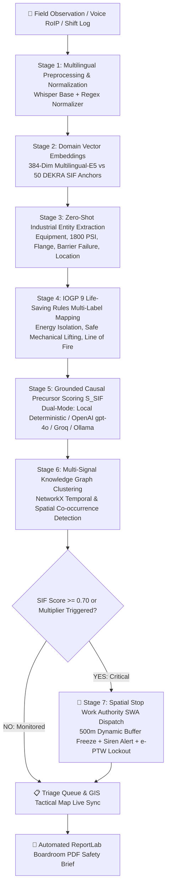

<div align="center">

# 🛡️ SANKET · AI
### SIF Precursor Detection & Autonomous Stop Work Authority Platform
**Smart India Hackathon 2026 · Problem Statement SIH26165**  
*Ministry of Petroleum and Natural Gas · Oil India Limited (OIL)*

[](https://nextjs.org/)
[](https://fastapi.tiangolo.com/)
[](https://supabase.com/)
[](https://openai.com/)
[](https://github.com/priy-anshugupta/Sanket-AI)
[](https://www.iogp.org/)
[](https://www.oisd.gov.in/)

> *"See the weak signal (Sanket) before it becomes the catastrophic blowout."*

</div>

---

## 📌 Executive Summary

**SANKET · AI** is an enterprise-grade, defense-calibrated safety intelligence platform engineered specifically for **Oil India Limited (OIL)** upstream exploration and drilling operations across the Upper Assam Basin. 

In high-consequence upstream operations, catastrophic disasters—such as the **2020 Baghjan Well #5 blowout**—are never spontaneous. They are preceded by clusters of unflagged, low-level **"weak signals"** (minor hydraulic valve weeping, 1800 PSI annular vibration surges, cellar pit gas bubbling) buried across handwritten shift logs, multilingual radio voice memos, and maintenance reports.

SANKET AI connects these isolated signals into a real-time, explainable **Serious Injury & Fatality (SIF) Precursor Detection Engine**, automatically calculating precursor probabilities, projecting toxic gas dispersion plumes, mapping International Association of Oil & Gas Producers (**IOGP**) Life-Saving Rules, and triggering automated **Stop Work Authority (SWA)** dynamic 500m digital permit lockouts.

---

## 🏛️ 7-Stage Sovereign SIF Pipeline Architecture

SANKET AI uses a **Deterministic + Neuro-Symbolic Hybrid Pipeline** designed to eliminate generative AI hallucinations in safety-critical environments while maintaining sub-second ($<0.2\text{s}$) latency:



---

## 🚀 The 10 Operational Workspaces

SANKET AI provides 10 purpose-built command interfaces tailored for both boardroom HSE directors and drill-floor roughnecks:

| # | Operational Workspace | Route | Core Mission & Features |
|---|---|---|---|
| **1** | **Triage Queue** | `/dashboard` | Central real-time incident queue with continuous $S_{\text{SIF}}$ risk scoring, Stage 3 NER decomposition tags, and 1-click CAPA work order dispatch. |
| **2** | **Upper Assam GIS Heatmap** | `/dashboard/heatmap` | Interactive Leaflet satellite map tracking all 10 OIL assets (Baghjan, Digboi, Moran OCS, Well Pad 7), real-time 245° toxic gas dispersion plumes, NASA FIRMS flare anomalies, and Brahmaputra flood inundation overlays. |
| **3** | **Emergency SWA Playbook** | `/dashboard/emergency` | High-consequence Stop Work Authority command console with 1-click rig siren activation, active e-PTW digital permit lockouts, and dynamic containment SOP checklists. |
| **4** | **DCS Control Room SCADA Wall** | `/dashboard/control-room` | Live physical telemetry wall monitoring real-time wellhead pressure surges, H2S gas levels, and DGMS / OISD-189 compliance health bars. |
| **5** | **Signal Knowledge Graph** | `/dashboard/graph` | Interactive Cytoscape graph visualizer illustrating multi-node causal paths connecting isolated minor observations across shifts into a unified failure cascade. |
| **6** | **Baghjan 2020 Disaster Replay** | `/dashboard/replay` | 14-day chronological counterfactual simulator proving how SANKET AI triggers automated SWA at Day 5—averting ₹580 Crores PSU financial loss, 3 fatalities, and 10,000 Ha ecological damage. |
| **7** | **Field Voice Reporter Studio** | `/dashboard/voice` | Web Audio waveform visualizer with on-device multilingual Whisper transcription supporting Assamese, Hindi, and English oilfield vernacular. |
| **8** | **System Security & Air-Gap Calibration** | `/dashboard/settings` | Real-time socket egress telemetry monitor (0 KB/s outbound), model RAM footprint monitor, and interactive SIF threshold calibration controls. |
| **9** | **Report Deep-Dive & Officer Audit** | `/dashboard/report/[id]` | Grounded 3-sentence causal explanation, Human-in-the-Loop review (Confirm, Upgrade, Downgrade), CAPA dispatcher, and ReportLab PDF compiler. |
| **10** | **ATEX Zone 1 Worker Terminal** | `/worker` | High-contrast, glove-friendly rugged mobile terminal featuring a giant Push-To-Talk voice button and 1-tap hazard presets (*Gas Kick / 1800 PSI*, *H2S Vapor*, *Unsafe Crane*, *PPE Hazard*). |

---

## 🔔 Real-Time Notification & Audio Chime Engine

- **Persistent Global Notification Center**: Features a header Bell icon with an animated unread badge and an interactive slide-down tray listing incoming field observations with reporter name, timestamp, risk badge, and direct incident links.
- **Pure Web Audio Chime Synthesizer**: Native in-browser tone generation ($880\text{Hz} \rightarrow 1174\text{Hz}$) requiring zero external audio downloads, with a global `[ 🔔 CHIME ON / MUTED ]` switch.
- **Cross-Center Zero-Reload Event Bus**: Ingested reports from mobile devices immediately update the Triage Queue table at Row #1 and adjust GIS asset pins in real-time.

---

## 📊 Baghjan 2020 Disaster Case Study: Counterfactual Proof

```
+-----------------------------------------------------------------------------+
|              BAGHJAN WELL #5 — 14-DAY DUAL REALITY COMPARISON               |
+------------------------------------+----------------------------------------+
|   2020 Historical Reality (Legacy) |     SANKET AI Sovereign Reality        |
+------------------------------------+----------------------------------------+
| Day 1–4: Valve weeping logged in   | Day 1: NLP maps weeping valve to       |
| paper logbook without SIF tag.     | Energy Isolation precursor.            |
|                                    |                                        |
| Day 5–9: 1800 PSI annular surge    | Day 5: Knowledge Graph links pressure  |
| dismissed as routine pump noise.   | + valve. SIF risk hits 94% HIGH.       |
|                                    |                                        |
| Day 14 (May 27): Catastrophic      | Automated Action: Instant SWA trigger. |
| uncontrolled wellhead blowout.     | Active e-PTWs frozen within 500m.      |
|                                    |                                        |
| Outcome: ₹580 Cr loss, 3 deaths,   | Outcome: Secondary BOP replaced under  |
| 173-day environmental inferno.     | isolation. ZERO injuries or blowout.   |
+------------------------------------+----------------------------------------+
| SCOREBOARD: 3 Lives Saved | ₹580 Cr Preserved | 10,000 Ha Wetlands Protected |
+-----------------------------------------------------------------------------+
```

---

## 🔑 Demo Access & Role-Based Credentials

The login portal at `/login` includes **1-Click Quick Demo Sign-In** pills for instant evaluator evaluation:

| Role | Username | Password | Operational Access Level |
|---|---|---|---|
| **HSE General Manager** | `rajesh` | `rajesh123` | Full Executive HQ Command Center, SWA Trigger, PDF Dispatch |
| **Site Safety Officer** | `priya` | `priya123` | Triage Queue, Human-in-the-Loop Feedback, CAPA Assignment |
| **Field Worker / Roughneck** | `bikash` | `bikash123` | Rugged ATEX Zone 1 Push-To-Talk Voice Terminal (`/worker`) |
| **System Administrator** | `admin` | `admin123` | Global System Controls, Model Settings, Air-Gap Diagnostics |

---

## 🛠️ Developer Quickstart & Installation

### Prerequisites
- **Python**: `3.11+`
- **Node.js**: `18.0+` (Next.js 16)
- **Database**: PostgreSQL (Pre-configured Supabase Tokyo cloud connection in `.env.example`)

### 1. Backend Setup
```bash
# Clone repository
git clone https://github.com/priy-anshugupta/Sanket-AI.git
cd Sanket-AI

# Create and activate virtual environment
python -m venv .venv
source .venv/bin/activate  # On Windows: .venv\Scripts\activate

# Install dependencies
pip install -r requirements.txt

# Configure environment variables
cp .env.example .env

# (Optional) Seed database with 553 Upper Assam safety reports
python scripts/seed_db.py

# Launch FastAPI backend server (Port 8000)
python -m uvicorn backend.main:app --host 127.0.0.1 --port 8000
```

### 2. Frontend Setup
```bash
# Navigate to frontend directory
cd frontend

# Install Node packages
npm install

# Start Next.js development server (Port 3000)
npm run dev
```

### 3. Open SANKET AI in Browser
- **Public Product Showcase:** [http://localhost:3000](http://localhost:3000)
- **Safety Manager HQ:** [http://localhost:3000/dashboard](http://localhost:3000/dashboard)
- **Field Worker Terminal:** [http://localhost:3000/worker](http://localhost:3000/worker)
- **Interactive OpenAPI Documentation:** [http://localhost:8000/docs](http://localhost:8000/docs)

---

## 🌐 Dual-Mode LLM Configuration

SANKET AI supports dual-mode execution via `backend/.env`:

1. **Air-Gapped Local Mode (Default - Zero API Keys Required)**:
   - Uses local sentence-transformers (`multilingual-e5-small`) and deterministic DEKRA decision rules with zero external cloud egress.
2. **Enhanced Online Cloud Mode (Optional)**:
   - Add your OpenAI or Groq key in `backend/.env`:
     ```env
     AI_MODE=online
     OPENAI_API_KEY=sk-proj-your_key_here
     OPENAI_MODEL=gpt-4o-mini
     # OR
     GROQ_API_KEY=gsk_your_key_here
     GROQ_MODEL=llama-3.3-70b-versatile
     ```

---

## 📂 Repository Architecture

```
Sanket-AI/
├── ai/                          # 5-Stage Scientific NLP & SIF Engine
│   ├── entities/                # Zero-shot industrial entity extraction (GLiNER / spaCy)
│   ├── explanation/             # Stage 5 LLM explainer (OpenAI / Groq / Ollama)
│   ├── lsr/                     # IOGP 9 Life-Saving Rules semantic mapper
│   ├── preprocessing/           # Multilingual normalizer (Assamese, Hindi, English)
│   ├── sif/                     # DEKRA SIF Potential Model & anchor vectors
│   └── voice/                   # On-device Whisper speech-to-text integration
├── backend/                     # FastAPI Modular Monolith Backend
│   ├── api/                     # REST API routers (reports, auth, graph, voice, etc.)
│   ├── auth/                    # JWT authentication & BCrypt password hashing
│   ├── config/                  # Pydantic central settings & thresholds
│   ├── db/                      # SQLAlchemy async engine & PostgreSQL session factory
│   ├── models/                  # Database ORM models (Report, User, Entity, Action)
│   ├── schemas/                 # Pydantic request/response validation models
│   ├── services/                # Business logic services
│   └── workers/                 # Async pipeline workers & batch processors
├── frontend/                    # Next.js 16 (React 19) Sovereign Frontend
│   ├── app/                     # App router views
│   │   ├── dashboard/           # 8 Manager Command Workspaces
│   │   │   ├── control-room/    # DCS SCADA telemetry wall
│   │   │   ├── emergency/       # SWA emergency lockout console
│   │   │   ├── graph/           # Cross-signal knowledge graph
│   │   │   ├── heatmap/         # Upper Assam GIS tactical map
│   │   │   ├── replay/          # Baghjan 2020 disaster scrubber
│   │   │   ├── report/[id]/     # Incident report detail view
│   │   │   ├── voice/           # Field voice reporter studio
│   │   │   ├── layout.tsx       # Executive sidebar with Notification Bell
│   │   │   └── page.tsx         # Triage Queue dashboard
│   │   ├── login/               # Sovereign dark authentication portal
│   │   ├── worker/              # ATEX Zone 1 rugged mobile terminal
│   │   ├── globals.css          # Unified industrial design tokens
│   │   └── page.tsx             # Scrollable public showcase & pipeline simulator
│   └── public/assets/           # Official SANKET AI derrick branding assets
├── data/                        # Curated SIF anchor libraries & IOGP taxonomies
├── documentation/               # Detailed technical PRDs & application specifications
├── scripts/                     # Synthetic data generators, seeders, and calibrations
└── requirements.txt             # Python dependencies
```

---

## 📜 Regulatory Standards & Statutory Alignment

- **DGMS (Directorate General of Mines Safety)**: Statutory Oil Mines Regulations compliance.
- **OISD-189 & OISD-GDN-206**: Standard Operating Procedures for well control and fire safety.
- **IOGP Reports 459 & 621**: Full international taxonomy mapping across 9 Life-Saving Rules.
- **DEKRA SIF Potential Model**: Multi-factor precursor risk matrix differentiating SIF potential from routine first-aid injuries.

---

<div align="center">
  <sub>Built with pride for <strong>Smart India Hackathon 2026</strong> · Empowering <strong>Oil India Limited</strong> with Sovereign AI.</sub>
</div>
